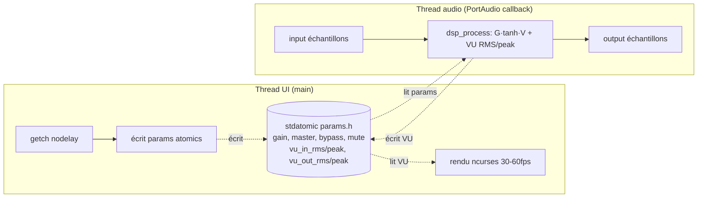

# TDP V1 — Terminal Distortion Pedal (C11, Ubuntu, ncurses + PortAudio) Design

Spec: `tdp-v1`  
Status: design-approved  
Created: 2026-10-11  
Brainstorm: `./brainstorm.md`
Requirements: `./requirements.md`

## Summary

TDP est une application C11 à **2 threads** qui ne se parlent que par `stdatomic` (lock-free) :

1. **Thread UI** (la `main`) : boucle ncurses, rendu ~30–60 fps, capture clavier non bloquante (`nodelay`+`getch`). Producteur de paramètres (Gain/Master/bypass/mute), consommateur des VU.
2. **Thread audio** (callback PortAudio) : exécuté par PortAudio à chaque bloc d'échantillons. Consommateur des paramètres, producteur des VU. Exécute la chaîne DSP `input → G → tanh → V → output` et le calcul RMS/peak.

Le cœur DSP (`dsp.c`) est du C pur sans dépendance PortAudio/ncurses → réutilisable pour un port futur (NFR-003). Toute la synchronisation passe par un bloc `params.h` de `stdatomic` : aucun mutex, aucune file de commandes.

## Goals and Non-Goals

### Goals

- G1: Chaîne DSP tanh mono + master correcte et testable sans carte son (FR-010..FR-013, NFR-005).
- G2: Partage d'état lock-free UI↔audio via `stdatomic` (FR-005..FR-009, FR-023).
- G3: Contraintes RT strictes respectées dans le callback (FR-021..FR-023, NFR-001).
- G4: TUI complète et contrôlable au clavier (FR-024..FR-035).
- G5: Build Makefile `make`/`clean`/`run`/`test` reproductible sur Ubuntu (FR-001..FR-004, NFR-002, NFR-004).
- G6: Documentation README conforme §6 (FR-036).

### Non-Goals

- Hot-swap de fréquence, multi-waveform, tone control, post-gain distinct, stéréo paramétrique, presets, CMake, CI, WASM, Windows, make-up gain auto, ring buffer de commandes (voir `requirements.md` → Out of Scope).

## Architecture



### Modules / fichiers

| Fichier | Rôle | Dépend |
|---------|------|--------|
| `Makefile` | Cibles `all`/`clean`/`run`/`test`, flags | — |
| `include/params.h` | Définition du bloc d'atomics + `params_init()` | `<stdatomic.h>` |
| `src/params.c` | Initialisation des atomics (défauts 0.5/0.75) | `params.h` |
| `include/dsp.h` | Prototype `dsp_process` + struct VU | `<math.h>`, `<stdint.h>` |
| `src/dsp.c` | Chaîne tanh + master + VU RMS/peak (C pur) | `math.h` |
| `include/audio.h` | Prototypes `audio_start`/`audio_stop`, état stream | PortAudio |
| `src/audio.c` | Callback PortAudio, ouverture stream mono, fallback sr/buffer | `PortAudio.h`, `dsp.h`, `params.h` |
| `src/main.c` | `main()`, init ncurses, boucle UI, clavier, rendu, shutdown | `ncurses.h`, `audio.h`, `params.h` |
| `tests/test_dsp.c` | Tests unitaires DSP, sans carte son | `dsp.h` |
| `README.md` | Doc conforme §6 | — |

### Choix buffer / sr (réponse aux open questions)

- **Buffer par défaut : 256 échantillons.** Raison : meilleur compromis latence/stabilité sur les backends PulseAudio/ALSA (le 128 peut « grésiller » sous charge). Latence DSP seule ≈ 256/48000 ≈ 5,3 ms, sous l'objectif ≤ 10 ms (NFR-001).
- **SR : demander 48000 Hz.** PortAudio renvoie le sr réel obtenu.
- **Fallback** : si `paOpenStream` échoue avec 48000/256, réessayer 44100/256, puis laisser PortAudio choisir (`paSampleRate` = sr préférence mais `framesPerBuffer` = 256). L'état réel (sr, buffer, OK/ERREUR) est stocké dans un `atomic`/struct lue par l'UI (FR-019, FR-020).

## Data Model

Bloc d'état partagé — `include/params.h` :

```c
typedef struct {
  _Atomic float  gain;            /* 0..1, défaut 0.5  (FR-005) */
  _Atomic float  master;          /* 0..1, défaut 0.75 (FR-006) */
  _Atomic bool   bypass;          /* FR-007 */
  _Atomic bool   mute;            /* FR-007 */
  _Atomic float  vu_in_rms;       /* 0..1 (FR-008) */
  _Atomic float  vu_in_peak;      /* 0..1, peak-hold (FR-008) */
  _Atomic float  vu_out_rms;      /* 0..1 (FR-008) */
  _Atomic float  vu_out_peak;     /* 0..1, peak-hold (FR-008) */
  /* état stream réel (lu par l'UI, écrit 1x au start) : */
  _Atomic long   sr;              /* Hz réel (FR-019) */
  _Atomic long   frame_buffer;    /* échantillons/bloc réel (FR-019) */
  _Atomic bool   pa_ok;           /* statut PortAudio (FR-020) */
} tdp_params;

extern tdp_params P;               /* instance unique, définie dans params.c */
void params_init(void);            /* pose les défauts */
```

- **Modèle d'accès** : UI écrit `gain/master/bypass/mute`, lit les `vu_*` + état stream. Audio lit `gain/master/bypass/mute`, écrit les `vu_*`. Tous les accès via `atomic_load`/`atomic_store` (ordonnancement `seq_cst` par défaut — suffisant pour des flags/floats, pas de risque ABA).
- **Paramètre sélectionné** (Gain vs Master) : état **local au thread UI** (un `int selected` dans `main.c`), non partagé → pas d'atomic (FR-032).
- **Peak-hold 500 ms** : tenu **dans le thread audio** (state local au callback : `float hold_in, hold_out` + compteur d'échantillons depuis le dernier peak). 500 ms ≈ `0.5 * sr` échantillons ; décroissance linéaire du hold quand aucun nouveau peak n'arrive.

### Chaîne DSP — `src/dsp.c`

```c
/* Traitement d'un bloc ; écrit out[], met à jour *vu (struct). C pur. */
void dsp_process(const float *in, float *out, long n,
                 float G, float V, bool bypass, bool mute,
                 float sr, dsp_vu *vu);
```

- `bypass` : `out = in` (signal sec), VU_out calculé sur `in` (FR-015).
- sinon : `y = tanh(G * in[i]) ; out[i] = V * y` (FR-010, FR-011).
- `mute` : `out[i] = 0` après le DSP (le DSP s'exécute quand même) ; VU_out = 0 (FR-016).
- VU_in : RMS de `in` sur le bloc (FR-012). VU_out : RMS de `out` (FR-013).
- Peak-hold mis à jour avec la fenêtre de 500 ms (FR-014). `rms` borné à [0,1].

## API / Interface Changes

Pas d'API réseau/persistance. Surface d'interaction = clavier + rendu TUI.

### Layout TUI

```
┌──────────────────────────────────────────────┐
│  TDP — Terminal Distortion Pedal      [ON]   │
│                                              │
│  > Gain   [=====-----]  50%                  │
│    Master [=========--]  75%                 │
│                                              │
│  INPUT   [######----------] -12.3 dB  peak   │
│  OUTPUT  [############---]  -4.1 dB  peak    │
│                                              │
│  48000 Hz · buffer 256 · PortAudio OK        │
└──────────────────────────────────────────────┘
```

- En-tête : titre + `[ON]`/`[BYPASS]` (BYPASS surligné) (FR-024).
- Ligne paramètre actif : préfixe `> ` (FR-025).
- Jauge paramètre : 12 cases, 10 %/case, + `%` (FR-026).
- VU : 20 cases + `dB` (`20·log10(rms)`, floor -60 dB) + `peak` (FR-027).
- Pied de page : `sr Hz · buffer N · PortAudio OK/ERREUR` (FR-028).

### Boucle UI (`src/main.c`)

```
initscr(); cbreak(); noecho(); nodelay(stdscr, TRUE);
params_init();
if (!audio_start()) { afficher ERREUR; loop limitee; }
while (!quit) {
    int key = getch();
    switch (key) { /* ESPACE/M/UP/DOWN/LEFT/RIGHT/R/q/CTRL-C (FR-030..035) */ }
    rendre();                    /* lit P.vu_*, P.sr, P.frame_buffer, P.pa_ok */
    napme(~16-33 ms);            /* ~30-60 fps */
}
audio_stop(); endwin();
```

### Mapping clavier

| Touche | Action | FR |
|--------|--------|----|
| `ESPACE` | `P.bypass = !P.bypass` | FR-030 |
| `M` | `P.mute = !P.mute` | FR-031 |
| `↑`/`↓` | `selected = 1 - selected` (Gain↔Master) | FR-032 |
| `←`/`→` | `param ∓/± 0.05`, clamp [0,1] | FR-033 |
| `R` | `P.gain=0.5; P.master=0.75` | FR-034 |
| `q` | `quit = true` | FR-035 |
| `CTRL-C` | `quit = true` (signal → drapeau) | FR-035 |

## Error Handling

- **Échec `paOpenStream`** : essai en cascade 48k/256 → 44k/256 → (sr default, 256). Si tous échouent : `P.pa_ok=false`, pied de page `PortAudio ERREUR`, la TUI reste utilisable (paramètres) mais aucun son. Pas de crash (FR-020).
- **`initscr` sans terminal** (pas de TTY) : message sur `stderr`, retour non nul.
- **RMS ≈ 0** : `dB` plafonné à -60 (pas de `log10(0)`).
- **Paramètres aux bornes** : clamp dans le handler ←/→ (FR-033, Edge Cases).
- **Fermeture ordonnée** : `q`/`CTRL-C` → `audio_stop()` (`paCloseStream`) puis `endwin()`, exit 0.
- **Pas de logging** en V1 (aucun I/O dans le thread audio — FR-022). L'UI est le seul observateur.

## Memory / Leak Checking (développement)

En plus des tests fonctionnels, on vérifie l'absence de **fuites mémoire** et d'accès invalide pendant le développement et les tests. C'est aussi un filet de sécurité pour les contraintes RT (FR-021 : pas de malloc dans le callback).

- **Outils** :
  - **Valgrind** (`memcheck`) — outil principal sur Linux. Install : `sudo apt install valgrind`.
  - Optionnel/complémentaire : **AddressSanitizer** (`-fsanitize=address,leak`) pour un retour plus rapide en dev (pas besoin de valgrind) ; utile aussi sur macOS où valgrind est moins adapté.
- **Cible `make check`** (ajoutée au Makefile) :
  - Exécute `tests/test_dsp` sous Valgrind : `valgrind --leak-check=full --show-leak-kinds=all --error-exitcode=99 ./build/test_dsp`.
  - Échoue (exit non nul) si Valgrind signale une fuite, un access invalide, ou un out-of-bounds. `--error-exitcode=99` rend l'échec exploitable par `make`.
- **Cible `make check-app`** (optionnelle, nécessite carte son + TTY) :
  - Exécute l'app réelle sous Valgrind avec une durée limitée (ex. timeout ~5 s) pour valider le chemin audio + ncurses : `valgrind --leak-check=full --error-exitcode=99 timeout 5 ./build/tdp || [ $? -eq 124 ]` (le timeout 124 est un « arrêt propre » attendu).
  - Note : Valgrind ralentit ~10–30× → la latence audio ne peut PAS être jugée sous Valgrind ; on ne l'utilise que pour les fuites/corruptions, pas pour le temps réel.
- **Sémantique** :
  - `make test` = correctness DSP (rapide, sans carte son).
  - `make check` = mémoire (valgrind sur les tests, sans carte son).
  - Les deux doivent passer avant de considérer une tâche terminée.
- **Contrainte valgrind/atomics** : les `stdatomic` simples (float/bool/long) sont gérés par Valgrind ; pas de fausse positive attendue. Si une fausse positive survient, on documente et on passe en `--track-origins=yes` pour trancher.
- **Règle de dev** : tout nouveau code audio/UI est passé sous `make check` avant validation ; aucune fuite tolérée (objectif `definitely lost: 0`).

## Security and Privacy

- Pas de réseau, pas de persistance, pas de secret. Surface = accès à la carte audio + clavier local.
- Un seul utilisateur local. Pas d'abuse case pertinent en V1.
- `CTRL-C` géré proprement (pas de stream audio orphelin).

## Testing Strategy

- **Unit tests (obligatoires, `make test`, sans carte son)** — `tests/test_dsp.c`, FR-004 :
  - `dsp_process` avec `in=[0]` → `out≈0` (tanh(0)=0) (FR-010).
  - Grandes entrées (±10, ±1e6) avec `G=1, V=1` → `out` borné dans [-1,1], **pas de NaN** (FR-011, Edge Cases).
  - `bypass=true` → `out == in` (FR-015).
  - `mute=true` → `out == 0`, VU_out = 0 (FR-016).
  - VU_in/VU_out RMS cohérents sur un signal connu (ex. sinusoïde → rms ≈ amp/√2) (FR-012, FR-013).
  - Peak-hold : après un pic, `vu_*_peak` ne baisse que linéairement sur la fenêtre 500 ms (FR-014).
  - Asserts simples, exit non nul au premier échec.
- **Integration** : couverte par `make run` (main + audio + dsp assemblés) — validée manuellement.
- **E2E / manuel** (`make run`) :
  - À l'oreille : le signal d'entrée est traité (distorsion audible à G élevé), bypass = signal sec, mute = silence.
  - Visuellement : TUI rend sélection/jauges/VU/en-tête/pied de page ; chaque touche produit l'effet attendu (FR-024..FR-035).
  - Pied de page affiche sr/buffer réels + `OK`.
- **Audit RT (FR-021..FR-023)** : revue de code du callback `audio.c` — aucun `malloc/free/printf/fopen/lock` ; lecture params uniquement via `atomic_load`. Documenté dans le commit/README.
- **Vérification mémoire (`make check`)** : Valgrind `memcheck` sur `test_dsp` (obligatoire) et, si possible, sur l'app réelle (`make check-app`). Objectif `definitely lost: 0`, aucun invalid access. Complément : AddressSanitizer en dev. (Voir section *Memory / Leak Checking*.)
- **Regression** : `make test` rejouable à chaque commit.

## Rollout and Migration

Pas de migration (repo vide). Séquence d'implémentation :
1. `Makefile` + `include/params.h` + `src/params.c` (squelette build + atomics).
2. `include/dsp.h` + `src/dsp.c` + `tests/test_dsp.c` → `make test` vert.
3. `include/audio.h` + `src/audio.c` (callback PortAudio mono + fallback sr/buffer).
4. `src/main.c` (ncurses, clavier, rendu, shutdown).
5. `README.md` conforme §6 + arbre du projet.
6. Validation finale : `make && make test && make check && make run`.

Rollback : chaque étape est un commit ; pas d'état externe.

## Requirements Traceability

| Requirement | Design Decision | Validation |
| ----------- | --------------- | ---------- |
| FR-001 | `Makefile` cible `all` → `build/tdp`, flags C11/pthread/portaudio/ncurses/m | `make` compile sans warnings |
| FR-002 | Cible `clean` → `rm -rf build/` | `make clean` |
| FR-003 | Cible `run` → `./build/tdp` | `make run` |
| FR-004 | Cible `test` compile `tests/test_dsp.c` sans PortAudio/ncurses, exit non nul si échec | `make test` |
| FR-005 | `_Atomic float gain` défaut 0.5 dans `tdp_params` | test + TUI |
| FR-006 | `_Atomic float master` défaut 0.75 | test + TUI |
| FR-007 | `_Atomic bool bypass`, `_Atomic bool mute` | TUI (ESPACE/M) |
| FR-008 | 4 `_Atomic float vu_*` bornés 0..1 | test VU + TUI |
| FR-009 | Tous les partages via `atomic_load/store`, pas de mutex | audit code |
| FR-010 | `dsp_process`: `y=tanh(G*x)`, `out=V*y` | test unitaire |
| FR-011 | tanh borne naturellement [-1,1], pas de limiteur | test bornes/NaN |
| FR-012 | VU_in = RMS du bloc sur `in` (avant DSP) | test RMS sinusoïde |
| FR-013 | VU_out = RMS du bloc sur `out` (après DSP) | test RMS |
| FR-014 | Peak-hold 500 ms décroissant, état local au callback | test peak-hold |
| FR-015 | `bypass` → `out=in`, VU_out sur `in` | test + à l'oreille |
| FR-016 | `mute` → `out=0` après DSP, DSP continue, VU_in continue | test + à l'oreille |
| FR-017 | `audio_start` ouvre stream mono, demande 48000/256 | `make run` |
| FR-018 | DSP+VU dans le callback PortAudio | architecture |
| FR-019 | sr/buffer réels stockés dans `P.sr`/`P.frame_buffer`, affichés | pied de page |
| FR-020 | `P.pa_ok=false` + `ERREUR` si `paOpenStream` échoue | pied de page |
| FR-021 | Callback sans malloc/free | audit code |
| FR-022 | Callback sans I/O/printf/lock | audit code |
| FR-023 | Lecture params via `atomic_load` uniquement | audit code |
| FR-024 | En-tête titre + `[ON]`/`[BYPASS]` (surligné) | `make run` visuel |
| FR-025 | Préfixe `> ` sur ligne sélectionnée | `make run` visuel |
| FR-026 | Jauge 12 cases + `%` | `make run` visuel |
| FR-027 | VU 20 cases + dB (floor -60) + peak | `make run` visuel |
| FR-028 | Pied de page `sr · buffer · OK/ERREUR` | `make run` visuel |
| FR-029 | `nodelay(stdscr,TRUE)` + `getch` dans boucle UI | architecture |
| FR-030 | `ESPACE` → `P.bypass=!P.bypass` | `make run` |
| FR-031 | `M` → `P.mute=!P.mute` | `make run` |
| FR-032 | `↑`/`↓` → `selected = 1-selected` | `make run` |
| FR-033 | `←`/`→` → param ∓/± 0.05, clamp [0,1] | `make run` |
| FR-034 | `R` → `gain=0.5, master=0.75` | `make run` |
| FR-035 | `q`/`CTRL-C` → `quit`, `audio_stop()`+`endwin()`, exit 0 | `make run` |
| FR-036 | `README.md` avec sections obligatoires + arbre | revue fichier |
| NFR-001 | buffer 256 @ 48k ≈ 5,3 ms DSP | `make run` (latence perçue) |
| NFR-002 | flags `-Wall -Wextra`, 0 warnings | `make` |
| NFR-003 | `dsp.c` C pur sans PortAudio/ncurses | audit modules |
| NFR-004 | Ubuntu, PortAudio≥19.7, ncurses≥6.0 | README/Makefile |
| NFR-005 | `make test` sans carte son ni TTY | `make test` |
| NFR-006 | Cible `make check` (Valgrind memcheck) sur les tests ; objectif 0 fuite, 0 invalid access | `make check` |

## Risks and Trade-offs

- **Latence ≤ 10 ms dépend du backend** (PulseAudio/ALSA) : on choisit 256 pour la stabilité ; si la latence perçue est trop haute, basculer sur 128 est un flag du Makefile/`audio.c`. Trade-off : 128 = plus de latence mais plus risqué (dropouts).
- **`float` atomique cross-platform** : `atomic<float>` est garantie sur les plateformes cibles (x86/ARM 64-bit). Accepté en V1 ; si un port futur l'interdit, on passe à `double`/`int32` quantifié.
- **Pas de ring buffer de commandes** : un flag atomique suffit (bypass/mute/params). Si V2 ajoute des commandes à séquence, il faudra un canal plus riche.
- **ncurses sous terminal non standard** : rendu supposé 80×24 ; si trop petit, on tronque (edge case acceptable V1).
- **Stéréo imposée par la carte** : on duplique le mono sur les 2 canaux ; la VU reste mono (représentative). Trade-off : pas de contrôle par canal (hors périmètre V1).
