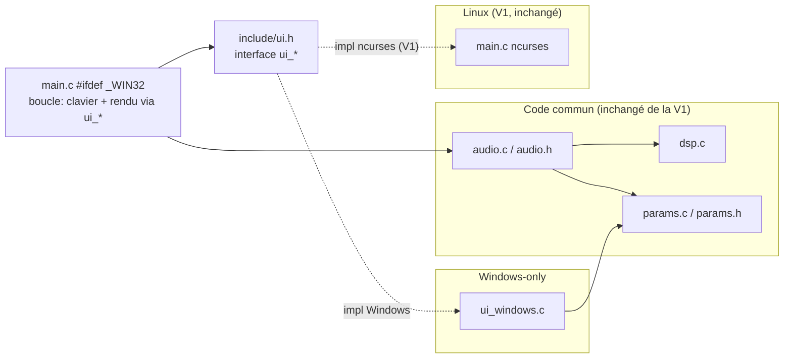

# TDP Windows — version compilée (console Windows native, sans ncurses) Design

Spec: `tdp-windows`  
Status: design-approved  
Created: 2026-10-11  
Brainstorm: `./brainstorm.md`
Requirements: `./requirements.md`

## Summary

La version Windows **réutilise tel quel** le cœur de la V1 : `src/dsp.c`, `src/params.c` (C pur + atomics) et `src/audio.c` (PortAudio). Seule la couche UI change : à la place de ncurses, on écrit `src/ui_windows.c` qui pilote la **console Windows native** (positionnement du curseur, blocs Unicode, couleurs, titre de fenêtre, clavier non bloquant).

La logique de rendu et de gestion clavier de `main.c` reste **commune** : on la factorise derrière une petite interface `ui_*` (`include/ui.h`). Le `main.c` de la V1 (ncurses) et un branchement `#ifdef _WIN32` (ou un `main_windows.c` mince) appellent la même boucle ; seul l'implémentant de `ui_*` diffère (ncurses vs Windows). Résultat : un `tdp.exe` + `portaudio.dll` dans un `dist/`, produit par MSYS2 (principal) ou `build_windows.bat` (secours).

## Goals and Non-Goals

### Goals

- G1: `tdp.exe` natif Windows, **sans ncurses**, rendu console Windows (blocs Unicode, couleurs, titre) (FR-004..FR-008).
- G2: Cœur DSP/params/audio **réutilisé sans modification**, même son que la V1 (FR-001..FR-003).
- G3: Parité de comportement (bypass/mute/VU/clavier/pied de page) avec la V1 (FR-010..FR-013).
- G4: Build reproductible Windows : MSYS2 (principal) + `build_windows.bat` (secours) → `dist/` (FR-014..FR-017).
- G5: Documentation README Windows (FR-018), contraintes RT préservées (FR-003, NFR-003).

### Non-Goals

- ncurses sous Windows, WASM/browser, CI, installeur, empaquetage au-delà de `dist/`, toute évolution DSP (hors V1), et la validation de compilation/run Windows **depuis cette machine** (à faire en session).

## Architecture



### Modules / fichiers

| Fichier | Rôle | Statut |
|---------|------|--------|
| `src/dsp.c`, `include/dsp.h` | Chaîne tanh + VU (C pur) | **inchangé** (V1) |
| `src/params.c`, `include/params.h` | Atomics partagées | **inchangé** (V1) |
| `src/audio.c`, `include/audio.h` | Callback PortAudio (RT) | **inchangé** (V1) |
| `include/ui.h` | Interface UI commune (`ui_*`) | **nouveau** |
| `src/ui_windows.c` | Impl `ui_*` console Windows (Unicode/couleurs/titre/clavier) | **nouveau** |
| `src/main.c` | Boucle commune : init `ui`, clavier, rendu, shutdown ; `#ifdef _WIN32` pour les appels d'init/shutdown spécifiques | **modifié** (factorise l'UI derrière `ui_*`) |
| `Makefile` | Cible Linux (V1) + cible `windows`/MSYS2 | **modifié** |
| `build_windows.bat` | Build secours MinGW → `dist/` | **nouveau** |
| `README.md` | Section Windows (build MSYS2 + .bat + dist + WSL2) | **modifié** |

> **Décision (open question)** : un **seul `main.c`** avec `#ifdef _WIN32` pour les points d'entrée UI (`ui_init`/`ui_shutdown` diffèrent), plutôt qu'un `main_windows.c` duplicata. La boucle clavier/rendu est commune et ne touche qu'à `ui_*`. Le fichier `src/ui_ncurses.c` (extract de la partie ncurses de l'ancien `main.c`) garde la cible Linux identique.

## Data Model

Aucune donnée persistante. L'état partagé reste `tdp_params` (inchangé). L'UI Windows maintient son propre état local (non partagé) :
- position curseur (colonne/ligne), taille console (cols/lines via `GetConsoleScreenBufferInfo`),
- dernier buffer de rendu (double-buffer en mémoire statique ou `static` pour éviter le flicker),
- état « paramètre sélectionné » (Gain vs Master) — local UI, comme la V1.

## API / Interface Changes

### Interface `include/ui.h` (commune)

```c
typedef enum { UI_KEY_NONE=0, UI_KEY_UP, UI_KEY_DOWN, UI_KEY_LEFT, UI_KEY_RIGHT,
               UI_KEY_SPACE, UI_KEY_M, UI_KEY_R, UI_KEY_Q } ui_key;

int  ui_init(void);            /* Windows : SetConsoleOutputCP(CP_UTF8), ANSI, taille */
void ui_shutdown(void);        /* Windows : restaurer console/couleur/cursor */
void ui_clear(void);           /* efface l'écran */
void ui_cursor(int row, int col);
void ui_text(int row, int col, const char *utf8); /* écrit une chaîne UTF-8 */
void ui_color(int color, int on); /* couleur par sémantique (BYPASS/sélection) */
void ui_title(const char *utf8);  /* SetConsoleTitle */
ui_key ui_poll_key(void);      /* non bloquant : une touche ou UI_KEY_NONE */
int  ui_cols(void); int ui_lines(void);
void ui_frame(void);           /* swap du double-buffer (Windows) / refresh (ncurses) */
```

### Layout (identique à la V1, rendu en blocs Unicode)

```
TDP - Terminal Distortion Pedal                    [ON]

> Gain   [████████████] 100%
  Master [████████░░░░]  75%

INPUT   [████████░░░░░░░░░░]  -4.1 dB  peak
OUTPUT  [████░░░░░░░░░░░░░░░░] -18.2 dB  peak

48000 Hz · buffer 256 · PortAudio OK
```

- Jauges paramètres : 12 cases en `█`/`░` + `%`.
- VU : 20 cases `█` (niveau) + `▓` (peak-hold) + `░` (vide) + `dB` (floor -60) + `peak`.
- En-tête `[ON]`/`[BYPASS]` : `BYPASS` en couleur (rouge) + titre fenêtre mis à jour.
- Pied de page : sr/buffer réels + `OK`/`ERREUR`.

### Clavier (non bloquant) — Windows

- `ui_poll_key()` : `PeekConsoleInput`/`ReadConsoleInput` sur le handle console ; traduit `KEY_EVENT_RECORD` → `ui_key` (flèches, espace, `M`/`m`, `R`/`r`, `q`/`Q`). `CTRL-C` → `ui_key Q` (ou signal → drapeau quit).
- Si le stdin n'est pas une console (redirigé) : `ui_poll_key` retourne `UI_KEY_NONE` en continu et l'app reste utilisable (rendu) ; le quit se fait via le titre/`q` quand possible.

## Error Handling

- **DLL PortAudio absente** : sous MinGW, le loader échoue au démarrage → `tdp.exe` ne démarre pas. On détecte via un message au démarrage : si `Pa_Initialize()` échoue → afficher `portaudio.dll introuvable ? Vérifiez qu'elle est à côté de tdp.exe.` et exit non nul (FR-017).
- **Pas de console** (lancé en double-clic sans terminal) : créer une console (`AllocConsole`) ou afficher un message ; comportement : `AllocConsole` puis UI.
- **Terminal sans couleur** : `ui_color` no-op si ANSI non supporté (détection `STDAPI GetConsoleMode`/Windows build) → rendu monochrome (NFR-004).
- **Console trop petite** : rendu tronqué proprement (comme la V1).
- **Fermeture ordonnée** : `q`/`CTRL-C` → `audio_stop()` + `ui_shutdown()` + exit 0.
- **Pas de logging** dans le thread audio (contrainte RT inchangée).

## Security and Privacy

- Pas de réseau, pas de persistance, pas de secret. Surface = carte audio + console locale.
- Un seul utilisateur local. `CTRL-C` géré proprement (pas de stream orphelin).
- Aucun droit d'administration requis.

## Testing Strategy

- **Unit tests DSP** : réutilisés de la V1 (`make test`, `make check`) — **inchangés**, valident le cœur réutilisé (FR-001, NFR-005). Sur Windows : `make test` via MSYS2 si gcc présent, sinon exécutés côté Linux (le code est identique).
- **Compilation Windows** (en session) :
  - MSYS2 : `make` (cible `tdp.exe`), 0 warning `-Wall -Wextra` (NFR-002).
  - `build_windows.bat` : génère `dist/tdp.exe` + `dist/portaudio.dll` + `dist/README.md` (FR-016).
- **Revue statique du code Windows** (faisable ici) :
  - `ui_windows.c` n'utilise que les API Windows + `ui.h` ; aucun `#include <ncurses.h>`.
  - `src/dsp.c`/`src/params.c`/`src/audio.c` byte-identiques à la V1 (diff vide).
  - Callback audio : toujours sans malloc/I-O/lock (audit).
- **E2E manuel (en session Windows)** :
  - Lancer `dist\tdp.exe` : TUI rend (blocs Unicode, couleurs, titre fenêtre), répond aux 8 touches.
  - Guitare branchée : son distordu ; BYPASS sec ; MUTE silence (VU IN continue) ; pied de page `OK`.
  - Supprimer `portaudio.dll` → message d'erreur lisible (FR-017).
- **Regression** : `make test`/`make check` (cœur) rejouables ; le build Windows rejouable via `.bat`.

## Rollout and Migration

Pas de migration (extension de la V1). Séquence :
1. `include/ui.h` (interface) + refactor `main.c` pour appeler `ui_*` (la cible Linux doit rester verte via `ui_ncurses.c`).
2. `src/ui_windows.c` (impl console Windows).
3. `Makefile` : cible MSYS2/`windows` (`tdp.exe`) + garde la cible Linux.
4. `build_windows.bat` → `dist/`.
5. `README.md` section Windows.
6. Validation : Linux (`make && make test && make check` inchangés) **ici** ; Windows (build + run) **en session**.

Rollback : les nouveaux fichiers sont additifs ; si le build Windows échoue, la V1 Linux est intacte.

## Requirements Traceability

| Requirement | Design Decision | Validation |
| ----------- | --------------- | ---------- |
| FR-001 | `dsp.c`/`params.c` inchangés, réutilisés | diff vide vs V1 |
| FR-002 | `audio.c` inchangé (fallback sr/buffer + RT) | diff vide vs V1 |
| FR-003 | Callback audio inchangé, contraintes RT | audit code |
| FR-004 | `ui_windows.c` via API console Windows, sans ncurses | compilation MSYS2 sans ncurses |
| FR-005 | `SetConsoleOutputCP(CP_UTF8)` + blocs █▓░ | run Windows (visuel) |
| FR-006 | Couleurs ANSI/SetConsoleTextAttribute + repli monochrome | run Windows (Win10 vs Win7) |
| FR-007 | `SetConsoleTitle` à chaque frame | run Windows (fenêtre) |
| FR-008 | Même layout V1 en blocs Unicode | run Windows (visuel) |
| FR-009 | `PeekConsoleInput`/`ReadConsoleInput` non bloquant, ~30-60 fps | run Windows (réactivité) |
| FR-010 | `ui_poll_key` → même mapping 8 touches que V1 | run Windows (clavier) |
| FR-011 | BYPASS via atomic (inchangé dsp.c) | run Windows (à l'oreille) |
| FR-012 | MUTE via atomic (inchangé dsp.c) | run Windows (à l'oreille) |
| FR-013 | VU dans le thread audio (inchangé) | run Windows (VU) |
| FR-014 | `Makefile` cible MSYS2/MinGW64 → `tdp.exe` | build MSYS2 |
| FR-015 | `build_windows.bat` (MinGW direct) | build .bat |
| FR-016 | `dist/` = tdp.exe + portaudio.dll + README.md | contenu dist/ |
| FR-017 | `Pa_Initialize()` échec → message DLL + exit non nul | run sans DLL |
| FR-018 | README section Windows (MSYS2 + .bat + dist + WSL2) | revue README |
| NFR-001 | buffer 256/128 (inchangé), latence à valider en session | run Windows |
| NFR-002 | flags `-Wall -Wextra` MinGW, 0 warning | build MSYS2/.bat |
| NFR-003 | appels Windows confinés à `ui_windows.c` | revue includes |
| NFR-004 | ANSI Win10/11, repli monochrome Win7 | run Windows |
| NFR-005 | build/run Windows validé en session ; cœur via make test/check ici | session + make test |

## Risks and Trade-offs

- **Build non validable ici** : pas de Windows/MinGW sur la machine de dev. Mitigation : le code Windows est écrit et revu statiquement ici ; la compilation/run se fait en session. Risque résiduel d'erreur de compilation API Windows → à corriger itérativement sur place.
- **DLL PortAudio** : le nom (`portaudio.dll` vs `libportaudio-0.dll`) et l'emplacement dépendent du toolchain (MSYS2 vs MinGW). Mitigation : `build_windows.bat`/Makefile copient la DLL du toolchain vers `dist/` ; message d'erreur lisible si absente (FR-017).
- **Unicode/couleurs** : certains terminaux Windows n'affichent pas les blocs ou les couleurs. Mitigation : repli propre (ASCII / monochrome), l'app reste utilisable (FR-006, NFR-004).
- **Clavier non bloquant** : `ReadConsoleInput` nécessite une console interactive ; si stdin redirigé, l'app reste en rendu mais sans clavier. Acceptable (edge case documenté).
- **Factorisation `main.c`** : refactoriser l'UI derrière `ui_*` touche le code Linux. Mitigation : la cible Linux doit rester verte (`make && make test && make check`) avant de valider — `ui_ncurses.c` préserve le comportement V1.
