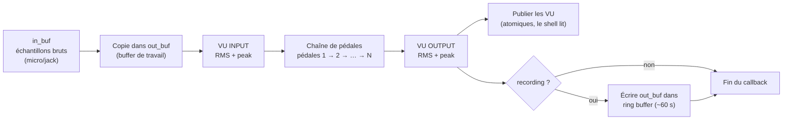
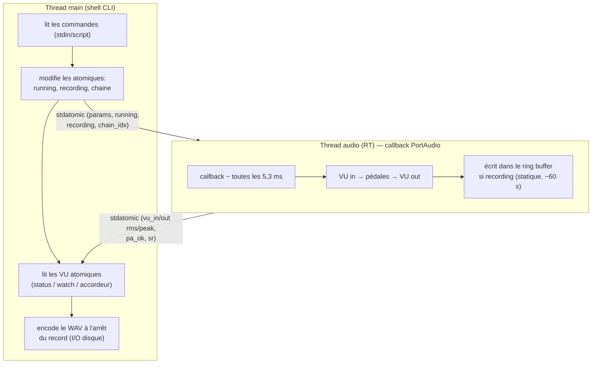

# Documentation — Terminal Distortion Pedal (TDP)

Une chaîne de pédales audio **temps réel** écrite en C11 + PortAudio, pilotée par un shell de commandes. Le même code tourne sous **Linux, macOS et Windows**.

Sommaire :

1. [Quickstart](#1-quickstart) — installer, lancer, enregistrer
2. [Théorie](#2-theorie) — le son, PortAudio, les canaux
3. [De l'entrée à la sortie](#3-de-lentree-a-la-sortie) — ce que fait le callback
4. [Les transformations (DSP)](#4-les-transformations-dsp)
5. [Gestion des threads audio](#5-gestion-des-threads-audio)

---

## 1. Quickstart

### 1.1 Installer

#### Option A — Binaire précompilé (sans compiler)

Chaque tag `v*` publie une **release GitHub** avec les binaires :
`tdp-linux.tar.gz` (Linux x86_64) et `tdp-windows.zip` (Windows x86_64,
avec `portaudio.dll` incluse).

- **Linux** : `apt install -y libportaudio2` (runtime), puis télécharger la
  release, dézipper, `./tdp`.
- **Windows** : télécharger `tdp-windows.zip`, dézipper, double-cliquer
  `tdp.exe`.

Pas de MSYS2 ni de compiler requis. Voir le [README](../README.md) pour les
détails.

#### Option B — Compiler depuis le source (Linux / macOS / WSL)

```bash
# 1. Dépendances (une fois)
sudo apt install -y build-essential portaudio19-dev valgrind git
# (Fedora : sudo dnf install gcc portaudio-devel make git)
# (macOS : brew install portaudio)

# 2. Cloner + compiler + lancer
git clone <repo> pedalboard-tui
cd pedalboard-tui
make && make run
```

Produit : `build/tdp`.

#### Option C — Compiler depuis le source (Windows natif, MSYS2)

1. Installer **MSYS2** (une fois) : <https://www.msys2.org/> → `C:\msys64`.
2. Ouvrir le shell **« MSYS2 MINGW64 »** (menu démarrer) — *pas* « MSYS2 » normal.
3. Installer les dépendances (une fois) :

   ```bash
   pacman -S --noconfirm \
     mingw-w64-x86_64-gcc \
     mingw-w64-x86_64-portaudio \
     make git unzip curl
   ```

   > En **UCRT64** (pas MINGW64) : `mingw-w64-ucrt-x86_64-gcc` et `mingw-w64-ucrt-x86_64-portaudio`.

4. Compiler :

   ```bash
   cd /c/Users/<utilisateur>/pedalboard-tui
   make dist          # -> dist/tdp.exe + portaudio.dll
   ```

5. Lancer : `dist/tdp.exe` (ou double-cliquer `run.bat`).

> `help` affiche le hash git du build (`v<hash>`). Si le shell ne démarre pas, vérifier que `portaudio.dll` est dans `dist/` à côté de `tdp.exe`.

### 1.2 Première session

Le shell démarre sur le prompt `tdp> ` :

```
tdp> in                 # lister les entrées audio (micro / jack guitare)
   [0] Microphone (Realtek)   [ALSA]
   [1] Carte de son (USB)     [ALSA]
tdp> in 1               # sélectionner l'entrée 1
tdp> out                # lister les sorties (casque / HP)
   [0] Sortie Realtek         [ALSA]
tdp> out 0              # sélectionner la sortie 0
tdp> load tdp/son_rock.tdp  # charger une chaîne de pédales (.tdp)
tdp> chain              # afficher la chaîne chargée
tdp> start              # démarrer le flux audio — le son passe par les pédales
```

Jouer de la guitare branchée sur l'entrée : le son traité sort sur la sortie.

### 1.3 Enregistrer

```
tdp> record             # commencer l'enregistrement (signal post-pédales)
   (jouer…)
tdp>                    # ← taper juste Entrée : arrête + sauvegarde
   enregistrement sauvegarde : recordings/2026-07-09_15-42-33.wav
tdp> stop
tdp> quit
```

Les fichiers WAV (PCM 16-bit, mono) atterrissent dans `recordings/` avec un nom horodaté.

### 1.4 Commandes de base

| Commande | Effet |
|----------|-------|
| `in` / `out` | Lister les entrées / sorties audio |
| `in N` / `out N` | Sélectionner le périphérique N |
| `load <fichier.tdp>` | Charger une chaîne de pédales |
| `chain` (alias `ls`) | Afficher la chaîne chargée |
| `start` / `stop` | Démarrer / arrêter le flux audio |
| `record` | Commencer l'enregistrement (post-pédales) |
| `<Entrée>` (record actif) | Arrêter l'enregistrement + sauvegarder le WAV |
| `status` (alias `s`) | Snapshot du niveau (RMS/peak in/out) + état |
| `watch` | Affichage continu du niveau (on/off) |
| `pedals` | Lister les pédales disponibles |
| `info <nom>` | Détails d'une pédale (params, min/max, défaut) |
| `test` | Accordeur : note + dérive en cents, en continu |
| `test_out` / `test_in` | Jouer un bip / tester le niveau de l'entrée |
| `reset` | Remettre les params de la chaîne aux défauts |
| `help` | Aide |
| `quit` | Quitter |

### 1.5 Confort clavier

| Touche | Action |
|--------|--------|
| `Tab` | Auto-complétion : commandes, pédales (`info <Tab>`), fichiers `.tdp` (`load <Tab>`) |
| `↑` / `↓` | Historique des commandes (32 dernières) |
| `Ctrl+C` | Quitter (équivalent `quit`) |
| `Ctrl+L` | Nettoyer l'écran |
| `Backspace` | Effacer |
| `<Entrée>` | Exécuter (ou stopper l'enregistrement) |

### 1.6 Mode script

`./build/tdp script.txt` exécute les commandes ligne par ligne, sans prompt, puis se termine. Utile pour les tests batch / CI.

---

## 2. Théorie

### 2.1 C'est quoi le son ?

Le son est une **pression d'air** qui varie dans le temps. Un micro (ou un jack guitare) la convertit en signal électrique proportionnel. Pour le numérique, on fait deux choses :

1. **Échantillonnage** : on mesure la valeur du signal à des intervalles réguliers. À **48 000 Hz**, on mesure 48 000 fois par seconde — chaque mesure s'appelle un *échantillon*. (Le théorème de Nyquist dit que l'on peut alors restituer fidèlement tout signal jusqu'à 24 kHz, i.e. au-delà de l'oreille humaine.)
2. **Quantification** : chaque mesure est stockée sur un nombre fini de bits. Ici TDP travaille en **float 32-bit** entre 0 et 1 (valeurs `[-1.0, +1.0]`) pour la précision, puis convertit en **PCM 16-bit** à l'enregistrement WAV.

Un fichier audio est donc une **liste de nombres** : une succession d'échantillons. TDP manipule cette liste en temps réel, un petit bloc à la fois.

### 2.2 Comment PortAudio met le son à disposition

**PortAudio** est une fine couche au-dessus des API audio natives (ALSA/WASAPI/Core Audio…) qui masque leurs différences. Son modèle clé :

- On lui décrit un **stream** : entrée, sortie, nombre de canaux, format des échantillons, fréquence d'échantillonnage, taille de bloc.
- On lui donne un **callback** : une fonction que PortAudio appelle **périodiquement, depuis son propre thread temps réel**, à chaque fois que le matériel a produit un bloc d'échantillons d'entrée (ou qu'il en faut pour la sortie).
- Dans ce callback, on reçoit le **buffer d'entrée** (les échantillons captés par le micro/jack) et on doit **remplir le buffer de sortie** avant de retourner.

TDP ouvre le stream ainsi (voir `try_open` dans `src/audio.c`) :

```c
inp.device    = device_choisie_ou_defaut;
outp.device   = device_choisie_ou_defaut;
inp.channelCount = 1;   // MONO
outp.channelCount = 1;  // MONO
inp.sampleFormat = paFloat32;
outp.sampleFormat = paFloat32;
inp.suggestedLatency = 0.0;  // latence minimale
Pa_OpenStream(&stream, &inp, &outp, sr, frames, paNoFlag, audio_callback, NULL);
```

Ensuite `audio_start` essaie plusieurs configurations, de la plus performante à la plus compatible :

1. 48 000 Hz, bloc 256
2. 44 100 Hz, bloc 256
3. 48 000 Hz, bloc 128
4. 48 000 Hz, bloc 256, devices par défaut (si les devices choisis échouent)

Avec un bloc de 256 échantillons à 48 kHz, PortAudio rappelle le callback toutes les **256 / 48 000 ≈ 5,3 ms**. C'est le rythme du temps réel : **tous les ~5 ms il faut avoir traité 256 échantillons**, sans raté.

### 2.3 Comment chaque canal est montré

**Canal** = une piste audio indépendante. Le stéréo standard = 2 canaux (gauche/droite). TDP traite en **mono** : un seul canal.

- **Entrée** : `inp.channelCount = 1`. Si la carte impose un nombre de canaux différent, PortAudio applique le mixage/resampling demandé, mais TDP lit un unique flot d'échantillons mono. Le signal d'une guitare (jack 6,35 mm ou micro) est naturellement mono.
- **Sortie** : `outp.channelCount = 1`. Le signal traité est envoyé sur un canal mono ; le système audio le diffuse (il sera en fait envoyé aux deux hauts-parleurs en double si la sortie est stéréo, selon la configuration matérielle).

Dans le callback, le « canal » est littéralement **un tableau `float` de `n` échantillons** :

```c
static int audio_callback(const void *in, void *out, unsigned long n, ...) {
  const float *in_buf  = (const float *)in;   // n échantillons d'ENTREE (le micro/jack)
  float       *out_buf = (float *)out;        // buffer de SORTIE à remplir (n float)
  ...
}
```

`n` est la taille du bloc (128 ou 256). C'est tout ce que PortAudio « montre » : deux tableaux de floats à la même fréquence d'échantillonnage.

---

## 3. De l'entrée à la sortie

Voici exactement ce que le callback fait à chaque bloc, dans l'ordre (`src/audio.c`, `audio_callback`) :



Détail des étapes :

1. **Aperçu pour l'accordeur** : une copie circulaire (`g_input_preview[4096]`) du signal brut est alimentée, pour que la commande `test` (accordeur) puisse analyser la fréquence sans gêner le flux.
2. **Copie** : `memcpy(out_buf, in_buf, n * sizeof(float))` — on travaille dans `out_buf`, c'est lui qui sera joué en sortie.
3. **VU entrée** : RMS + peak calculés **avant** les pédales.
4. **Chaîne de pédales** : `chain_process(&g_chain_active, out_buf, n)` parcourt les pédales chargées et applique chacune **en place** sur `out_buf`, dans l'ordre du fichier `.tdp`.
5. **VU sortie** : RMS + peak calculés **après** les pédales.
6. **Publication** : les 4 valeurs de VU sont écrites dans des variables `atomic_float` partagées ; le shell les lit pour `status`/`watch`.
7. **Enregistrement** : si `recording` est vrai, les échantillons **post-pédales** sont copiés dans un ring buffer pré-alloué (~60 s). À l'arrêt (Entrée), le thread main encode ce buffer en WAV.

Le signal de sortie est donc : **`entrée brute → [booster → distorsion → noise_gate → volume → …] → sortie de la carte son`**.

### 3.1 Changer de chaîne à chaud

`load fichier.tdp` reconstruit la chaîne et appelle `audio_set_chain`, qui **copie** la nouvelle chaîne dans un tampon statique puis bascule un index atomique (`g_chain_idx`) :

```c
void audio_set_chain(const chain_t *c) {
  if (c && c->len > 0) {
    g_chain_active = *c;   // copie dans le tampon statique
    g_chain_idx = 1;       // bascule atomique : le RT lit la nouvelle chaîne
  } else {
    g_chain_idx = 0;
  }
}
```

Le thread audio lit simplement l'index à chaque bloc. Pas de pointeur atomique (piège `_Atomic T*` en C11), pas de lock : on peut **changer de son pendant le jeu** sans coupure.

---

## 4. Les transformations (DSP)

Une « pédale » = une fonction `(buffer, n, état) → buffer` appliquée en place. Le catalogue `src/pedals.c` en définit 5 ; l'ordre dans le `.tdp` = l'ordre de traitement.

| Pédale | Paramètre | Défaut | Transformation |
|--------|-----------|--------|----------------|
| `booster` | `level` (0..2) | 1.5 | Gain linéaire propre : `y = x · level` (type TS9 level à fond) |
| `distortion` | `gain` (0..1) | 0.5 | Saturation douce : `y = tanh(gain · x)` |
| `noise_gate` | `threshold` (dB) | -45 | Si RMS du bloc < seuil → bloc mis à zéro (coupe le bruit entre les notes) |
| `volume` | `level` (0..1) | 0.75 | Master de sortie : `y = x · level` |
| `mute` | — | off | `y = 0` (silence total) |

```c
/* distortion : y = tanh(gain * x) — borne la sortie à [-1, 1] */
static void distortion_process(float *buf, int n, const pedal_state *st) {
  float gain = st->v[0];
  for (int i = 0; i < n; ++i) buf[i] = tanhf(gain * buf[i]);
}
```

**Pourquoi `tanh` ?** C'est une courbe de *soft clipping* : elle compresse les pics et laisse passer les amplitudes faibles presque linéairement, ce qui sonne comme une saturation d'amplification de guitare. Et comme `tanh(x) ∈ (-1, 1)` pour tout `x`, **la sortie est bornée par construction** — pas de limiteur nécessaire, pas de clipping dur ni de `NaN`, même si le booster en amont pousse fort.

Le `noise_gate` calcule le RMS du bloc courant et, s'il est sous le seuil (converti dB → linéaire par `10^(dB/20)`), met tout le bloc à zéro. C'est ce qui rend les chugs de metal nets : le bruit de fond entre les notes disparaît.

Un fichier `.tdp` est une pédale par ligne, `param=valeur`, `#` = commentaire :

```
# tdp/son_rock.tdp — crunch rock
booster level=1.8
distortion gain=0.45
noise_gate threshold=-42
volume level=0.8
```

Presets inclus (dossier `tdp/`) : `son_metal.tdp` (chug, gain élevé), `son_rock.tdp` (crunch), `son_clean.tdp` (pas de distorsion), `son_jazz.tdp` (doux), `son_blues.tdp` (legato + gate), `guitar_zombies_metal.tdp`, `clean_boost.tdp`.

---

## 5. Gestion des threads audio

L'application a **2 threads** qui ne se parlent que par des `stdatomic` (lock-free) :



### 5.1 Le thread audio (temps réel)

C'est le callback PortAudio, exécuté par le thread interne de PortAudio. Contraintes strictes, respectées :

- **Aucun `malloc`/`free`** — la chaîne de pédales est dans un tampon **statique** (`g_chain_active`), le ring buffer d'enregistrement est **pré-alloué** (`g_rec_buf[2 880 000]` ≈ 60 s à 48 kHz).
- **Aucun I/O** — pas de `printf`, pas d'écriture disque. Le WAV n'est encodé que par le thread main, **après** l'arrêt du record.
- **Aucun lock** — tout passe par `atomic_store/load` en `memory_order_relaxed` (suffisant pour des floats de VU et des bools d'état).
- **Lecture seule des atomiques** de commande : `running`, `recording`, `chain_idx`.

Le ring buffer d'enregistrement est la seule structure que le RT **écrit** en continu : un `head` circulaire + un compteur atomique de nombre d'échantillons écrits. Le thread main lit le compteur et copie quand il encode.

### 5.2 Le thread main (shell)

- Lit les commandes (interactif via `getchar`/`_getch`, ou script ligne par ligne).
- **Écrit** les atomiques : `running` (start/stop), `recording` (record), et la chaîne via `audio_set_chain`.
- **Lit** les atomiques de VU pour `status`/`watch` (conversion dB = 20·log₁₀(rms), plancher -60 dB), et le signal d'entrée brut pour l'accordeur (`test`).
- **Fait le seul I/O du programme** : encoder/sauvegarder le WAV (`recordings/<date>.wav`) et lire les fichiers `.tdp`.

### 5.3 Pourquoi ce modèle ?

Le thread audio a ~5 ms pour traiter 256 échantillons. Un `malloc`, un `printf` ou un lock mal placé peut **bloquer** ce thread → le son saccade ou coupe. En l'isolant strictement (mémoire statique, lock-free, zéro I/O), TDP garantit une latence faible et stable, et le shell peut faire tout ce qu'il veut (disque, fichiers, affichage) sans risque pour le son. C'est le schéma classique des applications audio temps réel.

---

## Voir aussi

- [`README.md`](../README.md) — commandes complètes, build & tests, structure du projet
- [`specs.md`](../specs.md) — spécifications techniques de conception
- `src/pedals.c` — le catalogue de pédales (source de vérité)
- `src/audio.c` — thread audio + callback PortAudio
- `src/shell.c` — le shell de commandes
